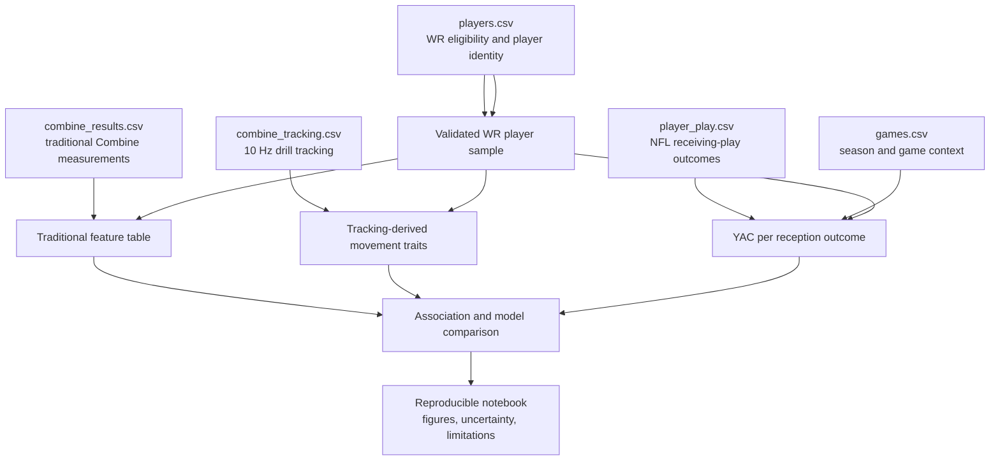

# NFL Combine traits and yards after catch architecture

This diagram shows the reproducible analysis pipeline for the project. The
analysis links pre-draft measurements to later NFL receiving performance while
keeping feature construction, outcome construction, and evaluation separate.

## Analysis safeguards

- Match records using `nfl_id` and report unmatched, duplicate, or ambiguous
  records before modeling.
- Define the receiver sample, observation window, and minimum-reception rule
  before comparing feature sets.
- Calculate YAC per reception from valid receiving plays; do not treat missing
  outcomes as zero.
- Compare traditional-only, tracking-only, and combined feature sets using the
  same eligible player sample and player-grouped validation.
- Describe associations rather than causation, and report sample and football
  context limitations.
