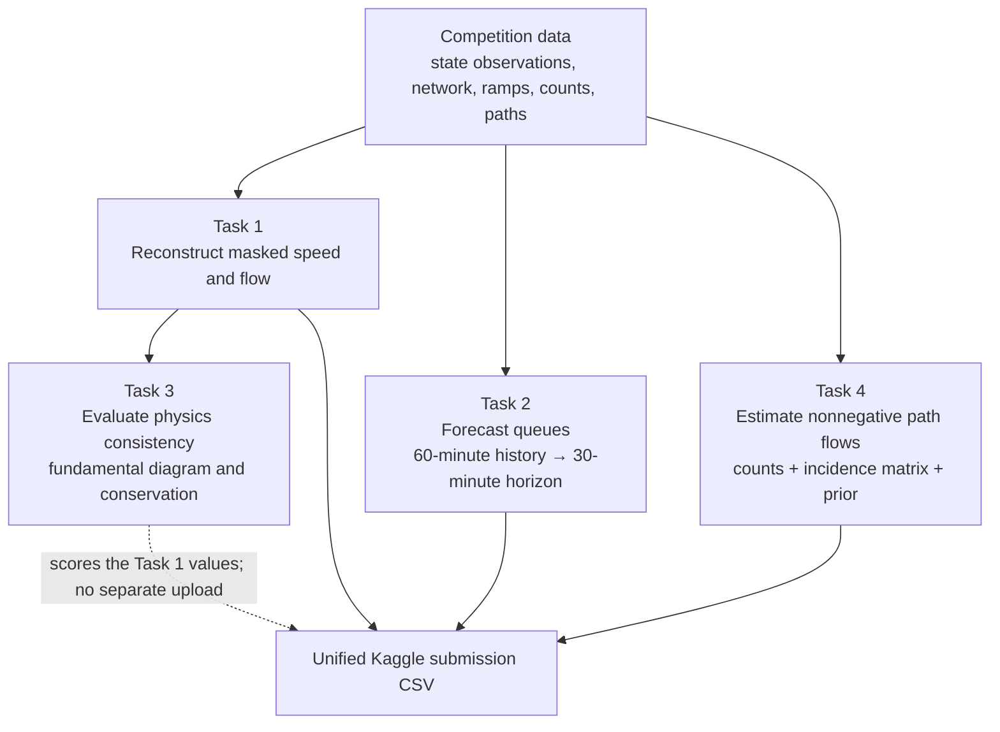

# Traffic-analysis pipeline

This diagram shows how the four competition tasks fit together. It deliberately
describes the project at a high level; model choices will be evaluated and
recorded during the project sprints.

## Interpretation

- **Task 1** produces reconstructed speed and flow values for masked state rows.
- **Task 3** evaluates those same Task 1 values for fundamental-diagram validity
  and vehicle conservation; it does not require a separate prediction file.
- **Task 2** is an online forecasting task: each window supplies 60 minutes of
  history and requires queue predictions for the next 30 minutes.
- **Task 4** is a separate origin-destination/path-flow estimation problem based
  on released link counts, paths, an incidence matrix, and a prior.
- The final upload combines Task 1, Task 2, and Task 4 rows into one CSV.
